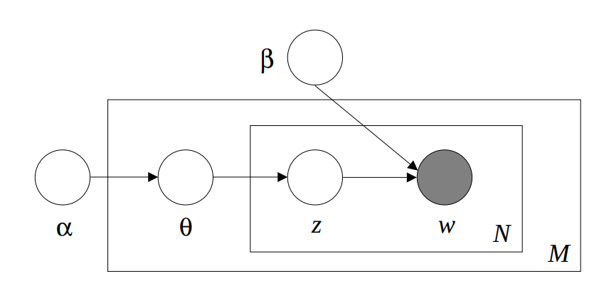

# Latent Dirichlet Allocation

LDA is one of the most well known and widely used topic models.
It is a bag-of-words topic model that models topics as word distributions drawn from a Dirichlet prior, and documents as mixtures of topics, with the mixture weights also having a  Dirichlet prior.

<figure>
  </img>
  <figcaption> Figure 1: Plate notation of LDA..<br> <i>Figure from Blei et al. (2003)</i> </figcaption>
</figure>


!!! note
    The Turftopic implementation of LDA is a thin wrapper around the scikit-learn implementation mainly for convenience and benchmarking.
    We recommend that you refer to [their documentation](https://scikit-learn.org/stable/modules/generated/sklearn.decomposition.LatentDirichletAllocation.html) for further details.

## Usage

```python
from turftopic import LDA

documents = [...]

model = LDA(10)
doc_topic_matrix = model.fit_transform(documents)
model.print_topics()
```

!!! tip
    Since LDA is a BoW topic model, it does not handle stop words particularly well.
    We recommend that you use a vectorizer that removes stop words or all too frequent words:
    ```python
    from turftopic import LDA
    from sklearn.feature_extraction.text import CountVectorizer

    model = LDA(10, vectorizer=CountVectorizer(min_df=10, stop_words="english", max_df=0.8))
    ```

## Citation

Please cite the authors of the paper, and Turftopic when using LDA:

```bibtex
@article{Blei2003,
    author = {Blei, David M. and Ng, Andrew Y. and Jordan, Michael I.},
    title = {Latent dirichlet allocation},
    year = {2003},
    issue_date = {3/1/2003},
    publisher = {JMLR.org},
    volume = {3},
    number = {null},
    issn = {1532-4435},
    abstract = {We describe latent Dirichlet allocation (LDA), a generative probabilistic model for collections of discrete data such as text corpora. LDA is a three-level hierarchical Bayesian model, in which each item of a collection is modeled as a finite mixture over an underlying set of topics. Each topic is, in turn, modeled as an infinite mixture over an underlying set of topic probabilities. In the context of text modeling, the topic probabilities provide an explicit representation of a document. We present efficient approximate inference techniques based on variational methods and an EM algorithm for empirical Bayes parameter estimation. We report results in document modeling, text classification, and collaborative filtering, comparing to a mixture of unigrams model and the probabilistic LSI model.},
    journal = {J. Mach. Learn. Res.},
    month = mar,
    pages = {993–1022},
    numpages = {30}
}

@article{
  Kardos2025,
  title = {Turftopic: Topic Modelling with Contextual Representations from Sentence Transformers},
  doi = {10.21105/joss.08183},
  url = {https://doi.org/10.21105/joss.08183},
  year = {2025},
  publisher = {The Open Journal},
  volume = {10},
  number = {111},
  pages = {8183},
  author = {Kardos, Márton and Enevoldsen, Kenneth C. and Kostkan, Jan and Kristensen-McLachlan, Ross Deans and Rocca, Roberta},
  journal = {Journal of Open Source Software} 
}
```


## API Reference

::: turftopic.models.bow.lda.LDA
