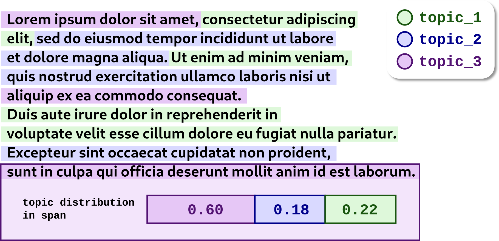

# Late Interaction Topic Models


Most topic models in Turftopic represent a corpus on the level of **documents**.
Late interaction or multi-vector topic models are different, as they can make use of embeddings of smaller units of text.
We term these units ***Spans***.

Spans can take many forms, and we let the user define, what unit they wish to do their analyses on e.g.:
<figure style="text-align: left; float: right;">
  
  <figcaption>Document with topic-annotated spans using a late interaction topic model.</figcaption>
</figure>

 1. The default unit is a **token**, tokens are determined by the language model that you use to produce embeddings for the topic model (aka the [Encoder](encoders.md)).
 2. You can use sliding **windows of tokens**, these are somewhat larger units, capturing more meaning at once, reducing the number of vectors to be processed.
 3. **Sentences** are also a natural boundary for Spans.
 4. Anything else...

 To learn more about Spans, check out the [Span extraction](spans.md) page.

## Usage Example

You can use a late model in Turftopic very similar to any other model.

There is, however, one big difference: since there are an uneven number of words in documents, it is also very likely that there is an unequal number of spans.
This means that we cannot use a regular array without padding or truncation.
Turftopic solves this problem with [Ragged Arrays](ragged_arrays.md).
Ragged arrays are expressed as regular Python objects, and all you have to know for now is that, instead of just a single embedding or document-topic matrix,
we now pass around both a ragged matrix and the character **Offsets** of the spans in the document.

In this example we will use [vSLDA](vSLDA.md):

```python
from turftopic import vSLDA

# vSLDA, by default, is a sentence-level topic model
model = vSLDA(
    10,
    encode_kwargs=dict(show_progress_bar=True),
    n_iter=50,
    span_extractor="sentence"
)
# The first object is a ragged array of the span-topic proportions
# the second one is a list of (span_start, span_end) tuples for each span in the document
doc_topic, offsets = model.fit_transform(corpus)
model.print_topics()
```

| Topic ID | Highest Ranking |
| - | - |
| 0 | alt, cobb, tek, vice, edu, bobbe, april, series, alexia, lis |
| 1 | physics, evolution, main, opinions, objective, agreed, scientists, model, petri, cheers |
| 2 | bank, germany, uiuc, access, pay, illinois, programs, straight, cheers, wide |
| 3 | motivated, jews, stalin, imo, wars, cheers, petri, wide, failed, killed |
| 4 | morality, moral, animals, cruel, goal, immoral, actions, society, natural, crime |
| 5 | text, texts, versions, mark, logically, john, language, copies, valid, essentially |
| 6 | islam, qur, rushdie, islamic, muslim, khomeini, muslims, fatwa, quran, secular |
| 7 | jesus, paul, liar, church, christ, young, believed, biblical, existed, believing |
| 8 | military, sell, war, arabia, saudi, figure, water, regards, east, nation |
| 9 | atheism, atheists, atheist, exist, god, belief, gods, faq, existence, faith |


## Model Interpretation

Most of the same interpretation utilities are available when it comes to late interaction models as with regular ones.
To learn more about those, check out the [Interpreting and Visualizing Models](model_interpretation.md) page.

### Top Spans

So far the only utilities specifically related to late interaction models are top span extraction.
Top spans can be printed, or exported in different formats:

=== "Pretty Print"

    ```python
    model.print_representative_spans(
        4, corpus, document_topic_matrix=doc_topic, offsets=offsets
    )
    ```


=== "`DataFrame`"

    ```python
    model.representative_spans_df(
        4, corpus, document_topic_matrix=doc_topic, offsets=offsets
    )
    ```

=== "Markdown"

    ```python
    model.export_representative_spans(
        4, corpus, document_topic_matrix=doc_topic, offsets=offsets, format="markdown"
    )
    ```

=== "Latex"

    ```python
    model.export_representative_spans(
        4, corpus, document_topic_matrix=doc_topic, offsets=offsets, format="latex"
    )
    ```

=== "CSV"

    ```python
    model.export_representative_spans(
        4, corpus, document_topic_matrix=doc_topic, offsets=offsets, format="csv"
    )
    ```

| Span | Score |
| - | - |
| Animals of the same species could kill each other arbitarily, but they don't. | 1.00 |
| In a natural sense, it is not at all immoral to harm another species (as long as it doesn't adversely affect your own, I guess). | 1.00 |
| .. So, only intelligent beings can be moral, even if the bahavior of other beings mimics theirs? | 1.00 |
| Well I agree with you in the sense that they have no "moral" right to inflict these rules, but there is one thing I might add: at the very least, almost everybody wants to avoid pain, and
if that means sacrificing some stuff for a herd morality, then so be it. | 1.00 |
... |  |


## API Reference 

### Abstract Base Class

::: turftopic.late.LateModel

### Encoder

::: turftopic.late.LateSentenceTransformer

