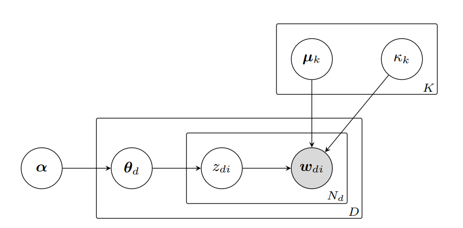

# vSLDA

vSDLA (Kobayashi et al., 2026) is a late-interaction probabilistic topic model that models as mixtures of von-Mises distributed embeddings.
The model is based on Latent Dirichlet Allocation, except its outcome distribution is a better fit for L2-normalized neural embeddings.


<figure>
  </img>
  <figcaption> Figure 1: Plate notation of the vSLDA model.<br> <i>Figure from Kobayashi et al. (2026)</i> </figcaption>
</figure>

## Usage

vSDLA is natively a multi-vector/late-interaction topic model. 
If you intend to use the model effectively you should make yourself familiar with [Turftopic's ragged array API](late_interaction.md).

The authors originally intend the model to be used on sentence level, but in Turftopic, one can use vSLDA on contextual windows or tokens.

!!! quote "Choose granularity and pooling"
    === "Token-level w/o Pooling"

        ```python
        from turftopic import vSLDA

        documents = [...]

        # pooling and window_size are default parameters,
        # you don't have to specify that they are None
        model = vSLDA(10, window_size=None, pooling=None)

        # The doc-topic matrix is a list of token-topic matrixes: (n_windows, n_topics)
        # offsets contains the character offsets of each token in (start, end) tuples,
        doc_topic_matrix, offsets = model.fit_transform(documents)

        model.print_topics()
        ```

    === "Window-level w/o Pooling"

        ```python
        from turftopic import vSLDA

        documents = [...]

        model = vSLDA(10, window_size=20, pooling=None)

        # The doc-topic matrix is a list of window-topic matrixes shape: (n_windows, n_topics)
        # offsets contains the character offsets of each window in (start, end) tuples,
        doc_topic_matrix, offsets = model.fit_transform(documents)

        model.print_topics()
        ```

    === "Token-level w Pooling"

        ```python
        import numpy as np
        from turftopic import vSLDA

        documents = [...]

        # We will use np.nanmean to pool token-level topic probabilities
        # One can also use other pooling techniques that respect the nature of probabilities
        # better
        model = vSLDA(10, pooling=np.nanmean)

        # The doc-topic matrix is a regular matrix, shape: (n_docs, n_topics)
        # No offsets are returned when pooling is specify
        doc_topic_matrix, offsets = model.fit_transform(documents)

        model.print_topics()
        ```

### Term importance estimation

vSLDA, similar to most other models in Turftopic, estimates term importances post-hoc.
Kobayashi et al. (2026) used NPMI for this purpose, which is also the default behaviour in Turftopic.
By default, however, Turftopic adds a smoothing term to the probability estimates instead of using frequencies, as very infrequent terms could dominate topics when one uses naive estimates.
Additionally, one can use a variety of different term importance estimation methods, some of which are embedding-based.

To read more about the different term importance estimation techniques, read our documentation page on [Clustering Topic Models](clustering.md) and [Topeax](Topeax.md).

!!! quote "Choose a term importance estimation method"
    === "NPMI (default)"

        ```python
        from turftopic import vSLDA

        documents = [...]

        model = vSLDA(10, feature_importance="npmi")
        doc_topic_matrix, offsets = model.fit_transform(documents)
        model.print_topics()
        ```

    === "Lexical-Semantic (recommended)"

        [Kardos (2026)](https://arxiv.org/abs/2601.21465) introduced a mixed method for estimating term importances in probabilistic embedding-based topic models,
        which combines NPMI, a term based measure, and a cosine distance based semantic measure.
        In our experience, this term importance method tends to be most robust and produces most interpretable topics, but more research remains to be done in this area.

        ```python
        from turftopic import vSLDA

        documents = [...]

        model = vSLDA(10, feature_importance="lexical-semantic")
        doc_topic_matrix, offsets = model.fit_transform(documents)
        model.print_topics()
        ```

    === "c-TF-IDF"

        ```python
        from turftopic import vSLDA

        documents = [...]

        model = vSLDA(10, feature_importance="c-tf-idf")
        doc_topic_matrix, offsets = model.fit_transform(documents)
        model.print_topics()
        ```

    === "Fighting Words"

        ```python
        from turftopic import vSLDA

        documents = [...]

        model = vSLDA(10, feature_importance="fighting-words")
        doc_topic_matrix, offsets = model.fit_transform(documents)
        model.print_topics()
        ```

### Choice of embedding model

The authors used `all-MiniLM-L6-v2` for most of their investigations, which is, incidentally, the default encoder model in Turftopic.
In addition, they they benchmarked MiniLM against two larger embedding models (`all-mpnet-base-v2` and `bge-base-en-v1.5`) and found no improvement.

It has to be noted, that none of the above models were developed for multi-vector tasks.
In Turftopic, vSLDA can be used with any embedding model, including `MultiVectorEncoder` and `SentenceTransformer` models.

!!! quote "Choose encoder model"
    === "`all-MiniLM-L6-v2` (default)"

        ```python
        from turftopic import vSLDA

        documents = [...]

        model = vSLDA(10, encoder="all-MiniLM-L6-v2")
        doc_topic_matrix, offsets = model.fit_transform(documents)
        model.print_topics()
        ```

    === "`jinaai/jina-embeddings-v5-text-small`"

        ```python
        import torch
        from turftopic import vSLDA

        documents = [...]

        model = vSLDA(
            10, 
            encoder="jinaai/jina-embeddings-v5-text-small",
            trf_kwargs=dict(
                trust_remote_code=True,
                device="cpu",
                model_kwargs={"dtype": torch.bfloat16}
            ),
            encode_kwargs=dict(task="clustering")
        )
        doc_topic_matrix, offsets = model.fit_transform(documents)
        model.print_topics()
        ```

    === "LateOn (native multi-vector retrieval model)"

        ```python
        from turftopic import vSLDA

        documents = [...]

        model = vSLDA(10, encoder="lightonai/LateOn")
        doc_topic_matrix, offsets = model.fit_transform(documents)
        model.print_topics()
        ```

## References

Please cite the original authors and Turftopic, when using vSLDA:

```bibtex
@misc{kobayashi2026vmfsentenceldaspherical,
      title={vMF Sentence LDA: A Spherical Topic Model over Sentence Embeddings}, 
      author={Ryotaro Kobayashi and Yuri Murayama and Kiyoshi Izumi},
      year={2026},
      eprint={2610.05095},
      archivePrefix={arXiv},
      primaryClass={cs.CL},
      url={https://arxiv.org/abs/2610.05095}, 
}

@article{
  Kardos2025,
  title = {Turftopic: Topic Modelling with Contextual Representations from Sentence Transformers},
  doi = {10.21105/joss.08183},
  url = {https://doi.org/10.21105/joss.08183},
  year = {2025},
  publisher = {The Open Journal},
  volume = {10},
  number = {111},
  pages = {8183},
  author = {Kardos, Márton and Enevoldsen, Kenneth C. and Kostkan, Jan and Kristensen-McLachlan, Ross Deans and Rocca, Roberta},
  journal = {Journal of Open Source Software} 
}
```

## API Reference
::: turftopic.models.vslda.vslda.vSLDA
